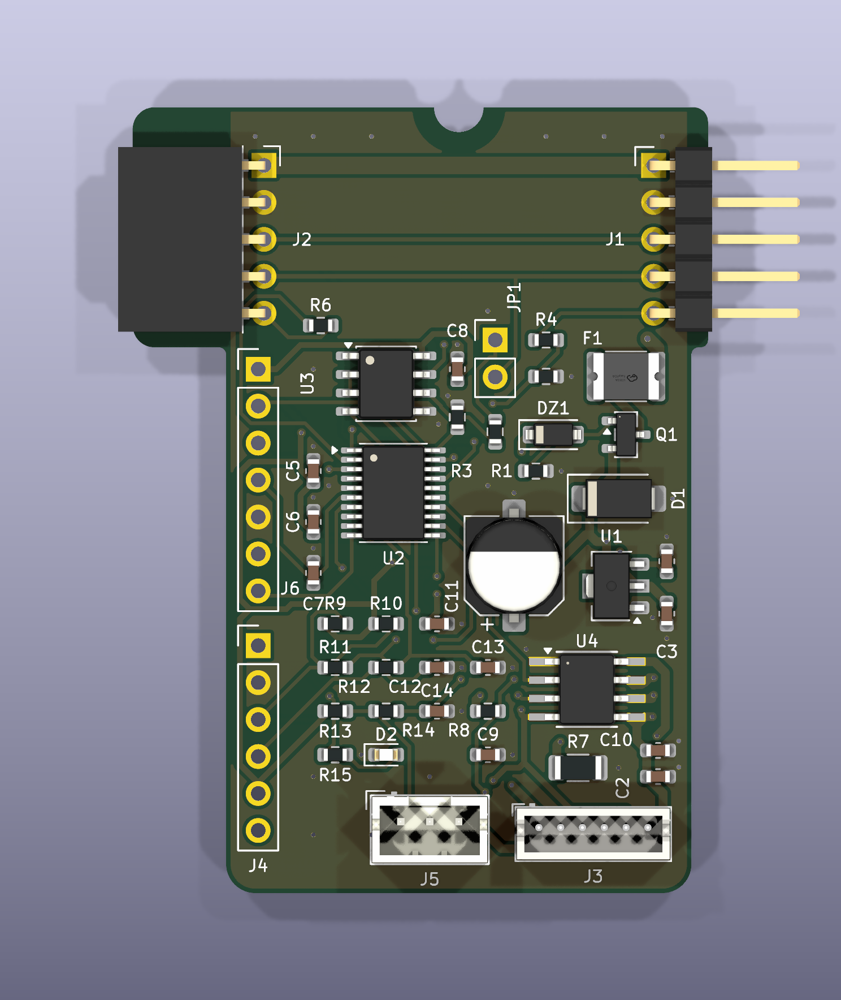

# Split-flap module board v0.1

**Status (2026-10-27): board #1 brought up** (power, SWD flash, LED, hall, encoder, motor drive all pass; see `design/DESIGN-1.md` section 14 and `firmware/ltm-bringup/`). **Next:** other 9 boards, ISEN, RS-485 + enumeration firmware.

**Status (2026-10-19): ordered.** ERC 0, DRC 0 errors / 0 unconnected; the files in `fab/` are what was ordered.

**Ordered 2026-10-19:** JLCPCB, 10 boards, Economic PCBA top side (green, 1.6 mm, HASL), est. ship 2026-10-23; C1 hand-solder caps from LCSC (20× C3151830, separate shipment).


Start with [`design/DESIGN-1.md`](design/DESIGN-1.md).

One small board per split-flap module (digit and name) of the [Premier League display](../../applications/premier-league/README.md): STM32G031 + DRV8870 driving one 12 V
N20 encoder motor, A3144 homing, RS-485 to a single ESP32 host, chained module-to-module through
right-angle headers on the board edges.

Board-to-board chaining and rail mounting in the enclosure follow the approach of dowjames'
SplitFlap PCB v5.1, and the hall sensor connector keeps its pinout so existing leads plug in.

```
design/
  DESIGN-1.md          requirements, decisions, parts, pin map, outline, open questions  <- read this
(project root)
  split-flap-module-board.kicad_pro/_sch    KiCad 10 project (generated by scripts/)
  split-flap-module-board-schematic.pdf
  split-flap-module-board.kicad_pcb         32 x 54 mm, 2 layers (generated by scripts/)
  split-flap-module-board.kicad_sym  project symbols (library sfmb:) (+12V_CHAIN/FUSED/LOCAL, GM3085E)
  fab/                 JLC package: gerbers/ + zip, BOM, CPL, STEP, layers PDF, check reports
    images/            top / bottom / 3D renders and screenshots
  scripts/             build.py: schematic + ERC + PDF + netlist
                       route_all.py: placement -> GND fan-out -> Freerouting -> stitch/fill -> silk ->
                       width audit -> DRC -> fab outputs (gen_board, stitch, autoroute, silk, widths,
                       outputs, jlc_cpl, snap, check_place)
```

```
python scripts/build.py        # schematic (seconds)
python scripts/route_all.py    # board + fab package (~10 min, Freerouting)
```
